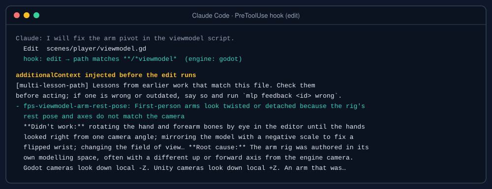
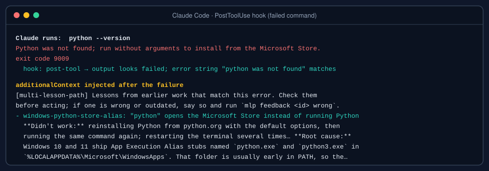
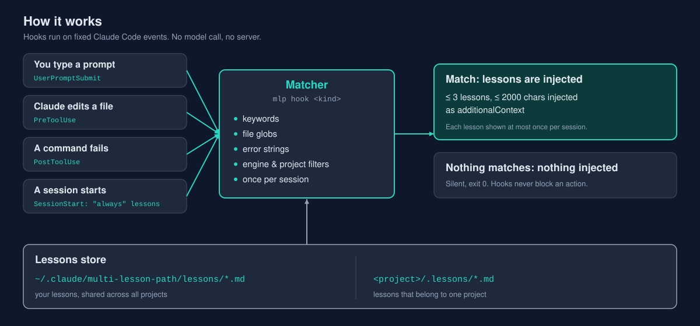
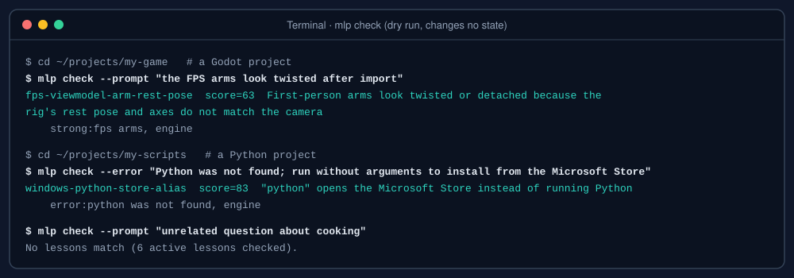
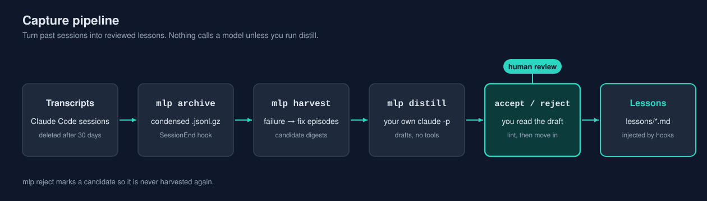

<p align="center"></p>

<p align="center">
  
  
  
  
</p>

# multi-lesson-path

Lessons that find you: cross-project memory for Claude Code, delivered by hooks.

multi-lesson-path keeps short, reviewed lessons from past work (what failed, why, and what fixed it) and injects the relevant ones into Claude Code when a matching situation starts: a prompt that mentions the problem, an edit to a related file, or a command whose output looks like the known failure. The agent does not have to remember to look.

## The problem

Coding agents forget between sessions. A fix that took an hour to find last week is rediscovered today, in the same project or in a different one, and the agent often walks through the same approaches that already failed.

The usual workaround is a memory file or a notes folder with a line such as "check your notes first". Two things go wrong with that:

- The file grows until nobody, human or agent, reads all of it. Everything is loaded every session, whether or not it is relevant.
- The instruction to check the notes is itself context, and it gets lost in long sessions, compaction, or a new project that never had the line.

multi-lesson-path moves the reading out of the agent's hands. Lessons are small files with explicit triggers. Hooks, which Claude Code runs deterministically on fixed events, decide when a lesson is relevant and add it to the context at that moment.

## What it looks like

When Claude is about to edit a file that a lesson covers, the lesson arrives before the edit:

<p align="center"></p>

When a command fails with a known error, the lesson arrives right after the failure:

<p align="center"></p>

## How it works

<p align="center"></p>

Key properties:

- **Deterministic.** Matching is keyword, path-glob and error-substring logic. The same input gives the same lessons. There is no model call on the hook path.
- **Bounded.** At most 3 lessons per injection, 600 characters per lesson body, 2000 characters for the whole context. Each lesson is shown at most once per session.
- **Silent when irrelevant.** If nothing matches, the hook prints nothing and exits 0. Hook failures never block the action Claude is taking.
- **Local.** Hooks send nothing anywhere. All data lives under one folder, `MLP_HOME`.

## Quick start

Requirements: Node.js 18 or newer. There are no npm dependencies.

```bash
git clone <repo-url> multi-lesson-path
cd multi-lesson-path
node bin/mlp.js install
```

`install` copies the program into `MLP_HOME/app` (default `~/.claude/multi-lesson-path`), creates the data folders, backs up your Claude Code settings file to `settings.json.bak-mlp-<timestamp>`, and adds five hook entries to `~/.claude/settings.json`. Running it again replaces only its own entries. Hooks run from the copy in `MLP_HOME/app`, so run `install` again after you pull updates to this repository. `mlp doctor` tells you when the copy is out of date.

The examples below write `mlp` for `node bin/mlp.js` from the repository. Add the repository's `bin` folder to your PATH, or use the full command, whichever you prefer.

Check that retrieval works with a dry run. It shows matches, scores and reasons and changes no state:

```bash
mlp check --prompt "python was not found after install"
```

Example dry runs against the bundled example lessons:

<p align="center"></p>

Create your first lesson:

```bash
mlp new my-first-lesson --title "Short description of the problem"
```

This writes a template to `MLP_HOME/lessons/my-first-lesson.md` and prints the path. Edit it, then validate:

```bash
mlp lint
mlp check --prompt "a sentence a future you would type when this problem appears"
```

To see working examples, copy them into your lessons folder. The files in `examples/lessons/` are generic and safe to use as a template:

```bash
cp examples/lessons/*.md ~/.claude/multi-lesson-path/lessons/
```

Start a new Claude Code session and ask a related question. The injected text appears in the session context as `[multi-lesson-path] ...`.

## Writing a lesson

A lesson is a Markdown file with a small front-matter block:

```markdown
---
id: windows-python-store-alias
title: "python" opens the Microsoft Store instead of running Python
keywords: python was not found, python command, microsoft store, python3, py launcher
strong: python was not found, app execution alias
min_match: 2
engines: python
errors: python was not found, run without arguments to install
---
**Didn't work:** reinstalling Python with the default options.

**Root cause:** the Windows App Execution Alias stub for python.exe comes before the real interpreter in PATH.

**Fix:** turn off the python.exe and python3.exe aliases in Settings, or use `py -3`.
```

The body is free Markdown. The convention of three labelled parts (**Didn't work:**, **Root cause:**, **Fix:**) keeps lessons short and makes the failed attempts explicit, so the next agent does not repeat them.

Full field reference, matching rules and ranking: [docs/lesson-format.md](docs/lesson-format.md). Example lessons: [examples/lessons/](examples/lessons/).

## Capture: turning past sessions into lessons

<p align="center"></p>

Writing lessons by hand works, but most useful lessons are already in past sessions. The capture pipeline helps find them:

1. **archive**: Claude Code deletes old transcripts after `cleanupPeriodDays` (30 days by default). A `SessionEnd` hook starts `mlp archive` in the background, which stores a condensed, gzip-compressed copy of each session under `MLP_HOME/archive/`. You can also run `mlp archive --all` once for existing transcripts.
2. **harvest**: scans the archive for failure-then-fix episodes: failing tool results, failing shell output, and user corrections, followed by a resolving step. Each episode becomes a candidate digest in `MLP_HOME/candidates/`.
3. **distill**: `mlp distill` sends one candidate digest to your own `claude` CLI (`claude -p`, no tools) and asks for a generalizable lesson, or `null` for one-off trivia. The result is a draft in `MLP_HOME/drafts/`. Nothing calls a model unless you run this command.
4. **accept or reject**: you read the draft. `mlp accept <draft-id> --edit` lints it and moves it into `lessons/`. `mlp reject <id>` marks the candidate so it is never harvested again.

Details, limits and flags: [docs/capture.md](docs/capture.md).

## Commands

Global flags: `--home <dir>` overrides `MLP_HOME` for one run; `--json` prints machine-readable output where supported. Run `mlp help <command>` for usage.

| Command | Purpose |
|---|---|
| `mlp install [--settings <file>] [--no-copy]` | Copy the program to `MLP_HOME/app`, create folders, back up and merge the five hook entries into Claude Code settings (default `~/.claude/settings.json`). Idempotent. |
| `mlp uninstall [--settings <file>]` | Remove only multi-lesson-path's hook entries. Keeps your data. |
| `mlp check (--prompt <text> \| --file <path> \| --error <text>) [--cwd <dir>]` | Dry run: prints which lessons would match, their scores and reasons. Writes no state and no log. |
| `mlp list` | Lists lessons with id, status, engines, hits (all time and last 30 days) and last hit. |
| `mlp show <id>` | Prints one lesson. |
| `mlp search <text>` | Substring search over id, title, keywords and body. |
| `mlp new <id> [--title …]` | Writes a lesson template into `lessons/` and prints its path. |
| `mlp lint` | Reports duplicate ids, missing fields, bad slugs, invalid globs, empty bodies and unknown keys. Exits 1 on errors. |
| `mlp stats [--days 30]` | Hits per lesson and per hook event. |
| `mlp review [--days 60]` | Lessons never hit, not hit recently, or with `wrong` feedback. Includes lint warnings. |
| `mlp feedback <id> helpful\|wrong [--note …]` | Records feedback. Lessons with repeated `wrong` feedback are ranked down and then dropped. |
| `mlp retire <id>` | Sets `status: retired`. Retired lessons never match. |
| `mlp doctor` | Checks Node version, `MLP_HOME`, freshness of the installed copy, hook entries in settings, lint summary and archive size. |
| `mlp privacy-check [paths…]` | Runs the privacy scanner over the given files (or staged files). See [docs/privacy.md](docs/privacy.md). |
| `mlp archive [--transcript <file>] [--all] [--full] [--roots <dir,…>]` | Condensed gzip archive of session transcripts. `--all` archives every transcript not yet archived or changed since. |
| `mlp harvest [--since <date>] [--project <substr>] [--limit N]` | Finds failure-to-fix episodes in the archive and writes candidate digests. Idempotent. |
| `mlp candidates [--json]` | Lists candidates with status: new, distilled or rejected. |
| `mlp distill [<candidate-id>\|--all] [--model haiku] [--limit N] [--dry-run]` | Turns candidates into draft lessons through your `claude` CLI. `--dry-run` prints the prompt only. |
| `mlp drafts` | Lists drafts waiting for review. |
| `mlp accept <draft-id> [--edit]` | Lints a draft and moves it into `lessons/`. |
| `mlp reject <id>` | Marks a candidate or draft as rejected. It is not harvested again. |
| `mlp hook <kind>` | Hook entry point (`prompt`, `edit`, `post-tool`, `session-start`, `session-end`). Used by Claude Code, not by people. |
| `mlp help [command]` | Usage for all commands or one command. |

Unknown commands print usage and exit 1.

## Configuration

Defaults work without any configuration. To override them, create `MLP_HOME/config.json`. Any key you omit keeps its default:

```json
{
  "maxLessons": 3,
  "maxChars": 2000,
  "bodyChars": 600,
  "transcriptRoots": ["~/.claude/projects"],
  "claudeBin": "claude",
  "distillModel": "haiku",
  "failureRegex": null,
  "extraCorrectionWords": []
}
```

| Key | Default | Meaning |
|---|---|---|
| `maxLessons` | 3 | Most lessons injected per hook call. |
| `maxChars` | 2000 | Most characters in one injected context. |
| `bodyChars` | 600 | Most characters of each lesson body injected. |
| `transcriptRoots` | `["~/.claude/projects"]` | Where `archive` looks for Claude Code transcripts. |
| `claudeBin` | `"claude"` | Command used by `distill`. Set a full path if `claude` is not on PATH. |
| `distillModel` | `"haiku"` | Model passed to `claude -p --model`. |
| `failureRegex` | `null` | Replaces the built-in failure-output pattern used by `harvest` and the post-tool hook. |
| `extraCorrectionWords` | `[]` | Extra words that count as a user correction during `harvest`. |

Other environment variables: `MLP_HOME` sets the data folder. `MLP_DISABLE=1` turns every hook into a no-op for one shell. Creating an empty file named `disabled` in `MLP_HOME` does the same for all sessions.

## Privacy

- Hooks never send data anywhere. They read the hook JSON from Claude Code, read the lesson files, and write local logs.
- The only network activity comes from `mlp distill`, which runs your own `claude` CLI, and only when you run it.
- All user data lives under `MLP_HOME`. Nothing is written into the repository.
- The repository contains only synthetic test fixtures and generic example lessons. A pre-commit privacy check refuses commits with home-folder paths of real users, e-mail addresses, or entries from your private deny-list.

What the archive contains, what is and is not encrypted, and how to delete it: [docs/privacy.md](docs/privacy.md).

## Compared with other approaches

**Memory files loaded every session** (one large instructions or notes file). This is simple and needs no tooling, and everything is always visible. The costs are that every session pays for all of it, the file grows without bound, and relevance is left to the reader. multi-lesson-path loads a few short lessons only when their triggers match, and it caps the size of what it adds.

**MCP-based memory tools** (a server the agent can query). These are flexible, and the agent can ask a precise question whenever it wants. The trade-off is that the agent must decide to call the tool, so retrieval depends on the model remembering to look, which is the failure this project is meant to avoid. A server process also adds moving parts. multi-lesson-path runs as plain hook commands that Claude Code invokes on fixed events, with no server and no model in the retrieval path.

The two can be used together. Hooks decide what is pushed; a tool can still be useful for deliberate searches.

## Limitations

- **Matching is lexical, not semantic.** Lessons match when the words in the prompt, the path, or the error output match the lesson's keywords. A problem described in very different words will not match until a keyword is added. Write keywords the way you and the agent will describe the problem, in more than one language if you work in several.
- **Lessons need curation.** Harvest and distill produce drafts, not finished knowledge. A bad lesson is injected as confidently as a good one. That is why acceptance is manual and why feedback exists.
- **Injection is advisory.** The text says "check these first". The agent can still ignore it, and the feedback command exists for lessons that were wrong or outdated.
- **Hook timing.** Hooks are designed to finish in under 150 ms with about 300 lessons. Very large lesson sets or a slow disk can exceed that.
- **Depends on Claude Code's hook interface.** The five hook events and their JSON shapes come from Claude Code. If that interface changes, `mlp doctor` and the hook error log are the first places to look.
- **Transcript format.** Harvest reads Claude Code's session transcript format. Unrecognized lines are skipped, but the episode detection is only as good as the format it sees.
- **No benchmarks.** This project does not publish measurements of how often lessons help. Use `mlp stats` and `mlp review` on your own data.

## Uninstall

```bash
node bin/mlp.js uninstall
```

This removes only multi-lesson-path's hook entries from your Claude Code settings. Your lessons, archive and logs stay in `MLP_HOME`. Delete that folder to remove all data. The settings backup created by `install` is kept as well.

## Documentation

- [docs/lesson-format.md](docs/lesson-format.md): front matter, matching rules, ranking, filters
- [docs/hooks.md](docs/hooks.md): the five hooks, their inputs, outputs and failure behavior
- [docs/capture.md](docs/capture.md): archive, harvest, distill, accept
- [docs/privacy.md](docs/privacy.md): what is stored, where, and what is never sent
- [docs/faq.md](docs/faq.md): common questions
- [CONTRIBUTING.md](CONTRIBUTING.md): development setup and rules for contributions
- [CHANGELOG.md](CHANGELOG.md): release history

## License

MIT. See [LICENSE](LICENSE).
