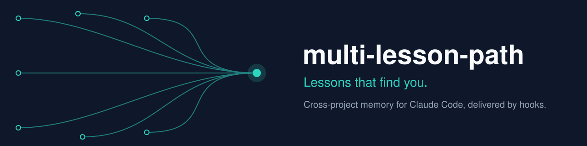
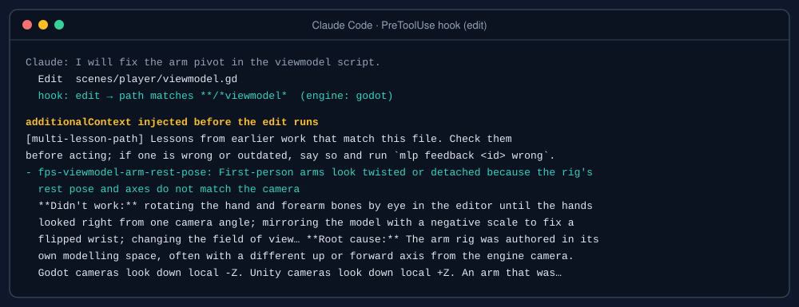
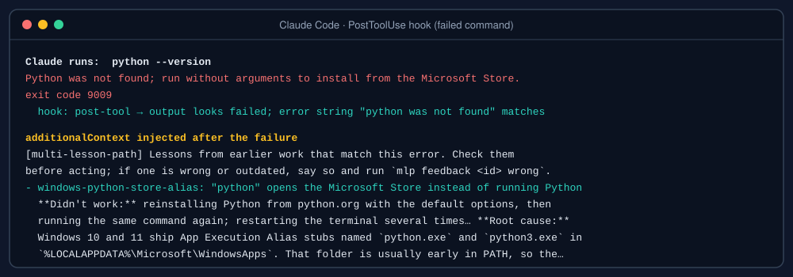
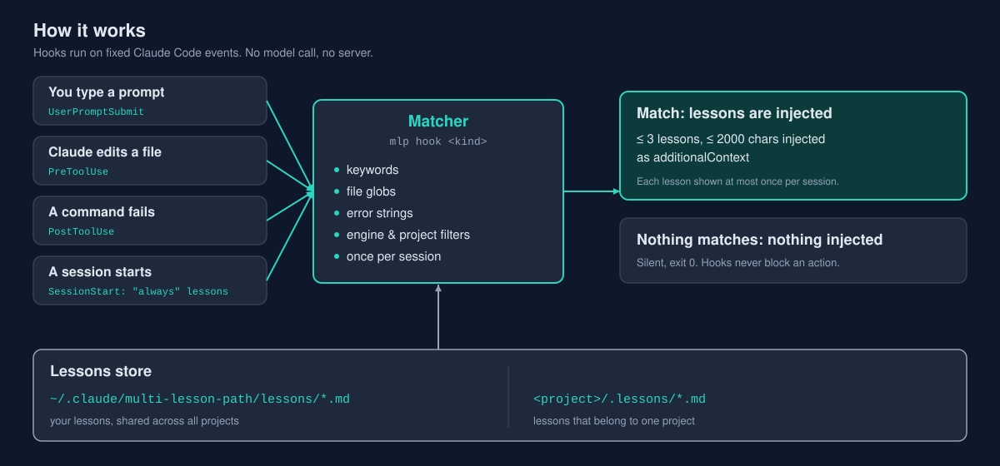
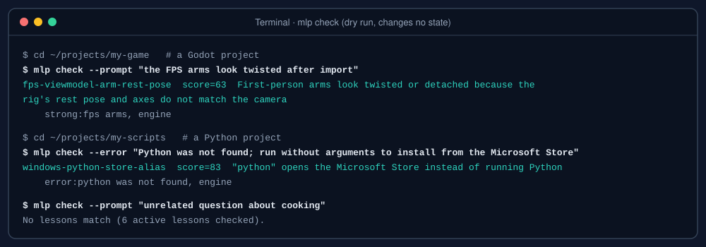
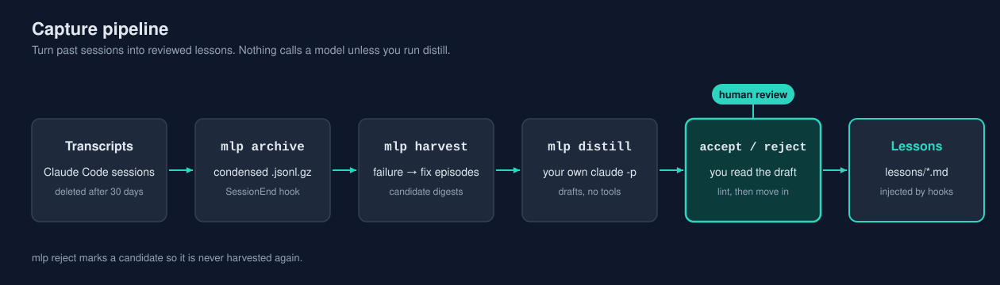
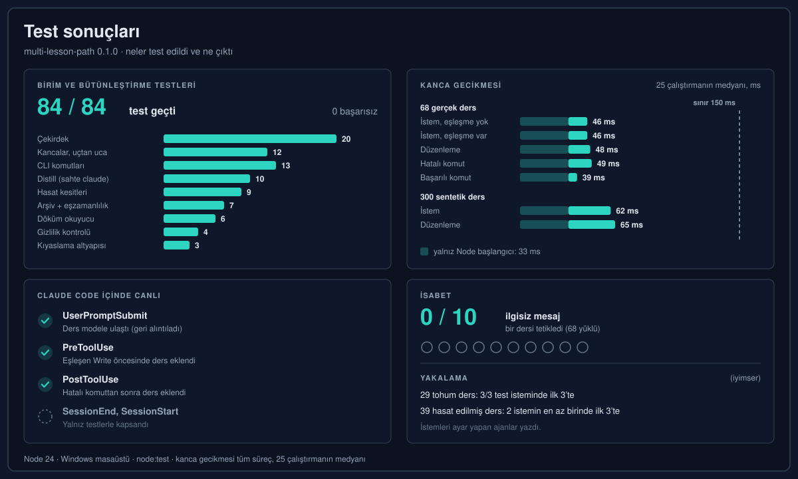
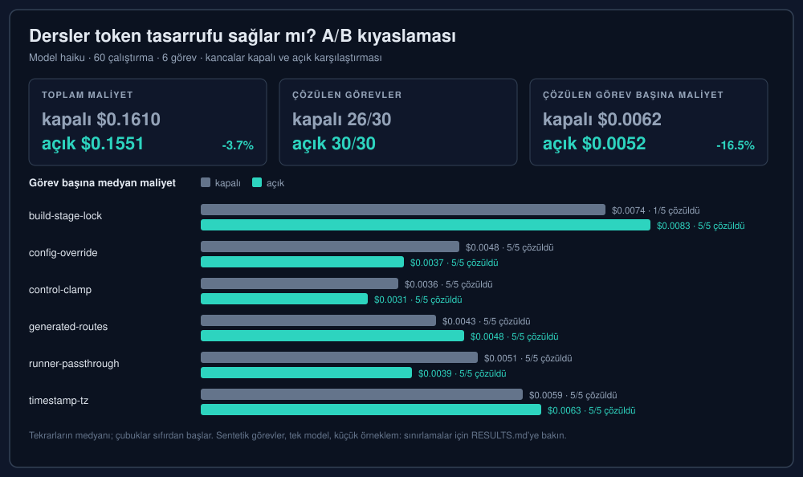

<p align="center"></p>

<p align="center">
  
  
  
  
</p>

**Dil:** [English](README.md) · Türkçe

# multi-lesson-path

Seni bulan dersler: Claude Code için projeler arası hafıza, kancalarla (hooks) gelir.

multi-lesson-path, geçmiş işlerden kısa ve gözden geçirilmiş dersleri tutar (neyin başarısız olduğunu, nedenini ve neyin düzelttiğini). Eşleşen bir durum başladığında bu dersleri Claude Code'a ekler: sorunu anlatan bir istem, ilgili bir dosyadaki düzenleme veya çıktısı bilinen hataya benzeyen bir komut. Ajanın bu dersleri hatırlayıp aramasına gerek yoktur.

## Sorun

Kodlama ajanları oturumlar arasında unutur. Geçen hafta bir saatte bulunan bir düzeltme, bugün aynı projede ya da başka bir projede yeniden keşfedilir ve ajan genellikle daha önce başarısız olmuş yaklaşımları yeniden dener.

Bunun için yaygın çözüm, "önce notlarını kontrol et" gibi bir satır içeren bir hafıza dosyası ya da not klasörüdür. Bununla iki sorun yaşanır:

- Dosya, ne insanın ne de ajanın hepsini okuyabileceği kadar büyür. Her oturumda, ilgili olup olmadığına bakılmadan her şey yüklenir.
- Notları kontrol etme talimatı da bir bağlam parçasıdır ve uzun oturumlarda, sıkıştırmada (compaction) ya da bu satır hiç bulunmayan yeni bir projede kaybolabilir.

multi-lesson-path okuma işini ajanın elinden alır. Dersler, açık tetikleyicileri olan küçük dosyalardır. Claude Code'un sabit olaylarda deterministik olarak çalıştırdığı kancalar, bir dersin ne zaman ilgili olduğuna karar verir ve o anda bağlama ekler.

## Nasıl görünüyor

Claude, bir ders kapsamındaki bir dosyayı düzenlemek üzereyken, ders düzenlemeden önce gelir:

<p align="center"></p>

Bir komut bilinen bir hatayla başarısız olduğunda ders, başarısızlıktan hemen sonra gelir:

<p align="center"></p>

## Nasıl çalışır

<p align="center"></p>

Temel özellikler:

- **Deterministik.** Eşleştirme anahtar kelime, yol deseni (glob) ve hata metni mantığıyla yapılır. Aynı girdi aynı dersleri verir. Kanca yolunda bir model çağrısı yoktur.
- **Sınırlı.** Her eklemede en fazla 3 ders, ders gövdesi başına en fazla 600 karakter ve tüm bağlam için en fazla 2000 karakter eklenir. Her ders bir oturumda en fazla bir kez gösterilir.
- **İlgisiz olduğunda sessiz.** Hiçbir şey eşleşmezse kanca hiçbir şey yazdırmaz ve 0 koduyla çıkar. Kanca hataları, Claude'un yaptığı işi asla engellemez.
- **Yerel.** Kancalar hiçbir yere veri göndermez. Tüm veriler `MLP_HOME` adlı tek bir klasörde durur.

## Hızlı başlangıç

Gereksinimler: Node.js 18 veya daha yeni. npm bağımlılığı yoktur.

```bash
git clone <repo-url> multi-lesson-path
cd multi-lesson-path
node bin/mlp.js install
```

`install`, programı `MLP_HOME/app` klasörüne kopyalar (varsayılan `~/.claude/multi-lesson-path`), veri klasörlerini oluşturur, Claude Code ayar dosyanı `settings.json.bak-mlp-<timestamp>` adıyla yedekler ve `~/.claude/settings.json` dosyasına beş kanca girdisi ekler. Komutu yeniden çalıştırmak yalnızca kendi girdilerini değiştirir. Kancalar `MLP_HOME/app` içindeki kopyadan çalışır, bu yüzden bu depodaki güncellemeleri çektikten sonra `install` komutunu yeniden çalıştır. `mlp doctor` kopyanın eski olup olmadığını söyler.

Aşağıdaki örneklerde `mlp`, depodan `node bin/mlp.js` anlamına gelir. Depodaki `bin` klasörünü PATH'ine ekleyebilir ya da tam komutu kullanabilirsin.

Geri çağırmanın çalıştığını kuru bir çalıştırmayla (dry run) kontrol et. Eşleşmeleri, puanları ve nedenleri gösterir, hiçbir durumu değiştirmez:

```bash
mlp check --prompt "python was not found after install"
```

Birlikte gelen örnek derslere karşı kuru çalıştırma örnekleri:

<p align="center"></p>

İlk dersini oluştur:

```bash
mlp new my-first-lesson --title "Short description of the problem"
```

Bu komut `MLP_HOME/lessons/my-first-lesson.md` dosyasına bir şablon yazar ve yolunu yazdırır. Dosyayı düzenle, sonra doğrula:

```bash
mlp lint
mlp check --prompt "a sentence a future you would type when this problem appears"
```

Çalışan örnekleri görmek için bunları ders klasörüne kopyala. `examples/lessons/` içindeki dosyalar genel amaçlıdır ve şablon olarak güvenle kullanılabilir:

```bash
cp examples/lessons/*.md ~/.claude/multi-lesson-path/lessons/
```

Yeni bir Claude Code oturumu başlat ve ilgili bir soru sor. Eklenen metin oturum bağlamında `[multi-lesson-path] ...` olarak görünür.

## Ders yazmak

Bir ders, küçük bir ön madde (front-matter) bloğu içeren bir Markdown dosyasıdır:

```markdown
---
id: windows-python-store-alias
title: "python" opens the Microsoft Store instead of running Python
keywords: python was not found, python command, microsoft store, python3, py launcher
strong: python was not found, app execution alias
min_match: 2
engines: python
errors: python was not found, run without arguments to install
---
**Didn't work:** reinstalling Python with the default options.

**Root cause:** the Windows App Execution Alias stub for python.exe comes before the real interpreter in PATH.

**Fix:** turn off the python.exe and python3.exe aliases in Settings, or use `py -3`.
```

Gövde serbest Markdown'dur. Üç etiketli bölüm kuralı (**Didn't work:**, **Root cause:**, **Fix:**) dersleri kısa tutar ve başarısız denemeleri açıkça yazar, böylece bir sonraki ajan aynı denemeleri tekrarlamaz.

Tüm alan başvurusu, eşleştirme kuralları ve sıralama: [docs/lesson-format.md](docs/lesson-format.md). Örnek dersler: [examples/lessons/](examples/lessons/).

## Yakalama: geçmiş oturumları derslere dönüştürmek

<p align="center"></p>

Dersleri elle yazmak mümkündür, ama en faydalı derslerin çoğu zaten geçmiş oturumlardadır. Yakalama hattı bunları bulmaya yardımcı olur:

1. **arşiv (`archive`)**: Claude Code, eski transkriptleri `cleanupPeriodDays` (varsayılan 30 gün) sonra siler. Bir `SessionEnd` kancası arka planda `mlp archive` komutunu başlatır. Bu komut, her oturumun yoğunlaştırılmış ve gzip ile sıkıştırılmış bir kopyasını `MLP_HOME/archive/` altında saklar. Mevcut transkriptler için `mlp archive --all` komutunu bir kez de çalıştırabilirsin.
2. **hasat (`harvest`)**: Arşivi, başarısızlık-sonra-düzeltme bölümleri için tarar: başarısız araç sonuçları, başarısız kabuk çıktıları ve kullanıcı düzeltmeleri, ardından çözen bir adım. Her bölüm, `MLP_HOME/candidates/` içinde bir aday özet (digest) olur.
3. **damıtma (`distill`)**: `mlp distill`, bir aday özeti kendi `claude` CLI'ına (`claude -p`, araçsız) gönderir ve genelleştirilebilir bir ders ister. Tek seferlik önemsiz bilgilerde sonuç `null` olur. Sonuç, `MLP_HOME/drafts/` içinde bir taslaktır. Bu komutu çalıştırmadıkça hiçbir model çağrılmaz.
4. **kabul ya da red**: Taslağı okursun. `mlp accept <draft-id> --edit` taslağı denetler ve `lessons/` klasörüne taşır. `mlp reject <id>` adayı işaretler, böylece bir daha hasat edilmez.

Ayrıntılar, sınırlar ve bayraklar: [docs/capture.md](docs/capture.md).

## Komutlar

Genel bayraklar: `--home <dir>` tek bir çalıştırma için `MLP_HOME` değerini geçersiz kılar; `--json` destekleyen yerlerde makine tarafından okunabilir çıktı verir. Kullanım bilgisi için `mlp help <command>` çalıştır.

| Komut | Amaç |
|---|---|
| `mlp install [--settings <file>] [--no-copy]` | Programı `MLP_HOME/app` içine kopyalar, klasörleri oluşturur, Claude Code ayarlarını (varsayılan `~/.claude/settings.json`) yedekler ve beş kanca girdisini bu dosyaya birleştirir. Tekrarlanabilir: aynı sonucu verir. |
| `mlp uninstall [--settings <file>]` | Yalnızca multi-lesson-path'in kanca girdilerini kaldırır. Verilerini korur. |
| `mlp check (--prompt <text> \| --file <path> \| --error <text>) [--cwd <dir>]` | Kuru çalıştırma: hangi derslerin eşleşeceğini, puanlarını ve nedenlerini yazdırır. Durum ya da günlük yazmaz. |
| `mlp list` | Dersleri kimlik, durum, motorlar, isabetler (tüm zamanlar ve son 30 gün) ve son isabet bilgisiyle listeler. |
| `mlp show <id>` | Bir dersi yazdırır. |
| `mlp search <text>` | Kimlik, başlık, anahtar kelimeler ve gövde üzerinde alt dizi araması yapar. |
| `mlp new <id> [--title …]` | `lessons/` içine bir ders şablonu yazar ve yolunu yazdırır. |
| `mlp lint` | Yinelenen kimlikleri, eksik alanları, hatalı slug'ları, geçersiz glob'ları, boş gövdeleri ve bilinmeyen anahtarları bildirir. Hata varsa 1 koduyla çıkar. |
| `mlp stats [--days 30]` | Ders başına ve kanca olayı başına isabetleri gösterir. |
| `mlp review [--days 60]` | Hiç isabet almamış, yakın zamanda isabet almamış ya da `wrong` geri bildirimi olan dersleri listeler. Lint uyarılarını da içerir. |
| `mlp feedback <id> helpful\|wrong [--note …]` | Geri bildirim kaydeder. Tekrarlanan `wrong` geri bildirimi alan dersler önce sıralamada aşağı çekilir, sonra tamamen düşürülür. |
| `mlp retire <id>` | `status: retired` olarak ayarlar. Emekli dersler hiçbir zaman eşleşmez. |
| `mlp doctor` | Node sürümünü, `MLP_HOME` değerini, kurulu kopyanın güncelliğini, ayarlardaki kanca girdilerini, lint özetini ve arşiv boyutunu denetler. |
| `mlp privacy-check [paths…]` | Verilen dosyalar (ya da sahneye alınmış dosyalar) üzerinde gizlilik tarayıcısını çalıştırır. Bkz. [docs/privacy.md](docs/privacy.md). |
| `mlp archive [--transcript <file>] [--all] [--full] [--roots <dir,…>]` | Oturum transkriptlerinin yoğunlaştırılmış, gzip sıkıştırılmış arşivi. `--all`, henüz arşivlenmemiş ya da o zamandan beri değişmiş her transkripti arşivler. |
| `mlp harvest [--since <date>] [--project <substr>] [--limit N]` | Arşivde başarısızlıktan düzeltmeye kadar olan bölümleri bulur ve aday özetleri yazar. Tekrarlanabilir. |
| `mlp candidates [--json]` | Adayları durumlarıyla listeler: new, distilled veya rejected. |
| `mlp distill [<candidate-id>\|--all] [--model haiku] [--limit N] [--dry-run]` | Adayları `claude` CLI'ın üzerinden taslak derslere dönüştürür. `--dry-run` yalnızca istemi yazdırır. |
| `mlp drafts` | İncelemeyi bekleyen taslakları listeler. |
| `mlp accept <draft-id> [--edit]` | Bir taslağı denetler ve `lessons/` içine taşır. |
| `mlp reject <id>` | Bir aday ya da taslağı reddedilmiş olarak işaretler. Bir daha hasat edilmez. |
| `mlp hook <kind>` | Kanca giriş noktası (`prompt`, `edit`, `post-tool`, `session-start`, `session-end`). Claude Code tarafından kullanılır, insanlar tarafından değil. |
| `mlp help [command]` | Tüm komutların ya da tek bir komutun kullanımını gösterir. |

Bilinmeyen komutlar kullanımı yazdırır ve 1 koduyla çıkar.

## Yapılandırma

Varsayılanlar yapılandırma olmadan çalışır. Bunları geçersiz kılmak için `MLP_HOME/config.json` dosyasını oluştur. Yazmadığın her anahtar varsayılan değerini korur:

```json
{
  "maxLessons": 3,
  "maxChars": 2000,
  "bodyChars": 600,
  "transcriptRoots": ["~/.claude/projects"],
  "claudeBin": "claude",
  "distillModel": "haiku",
  "failureRegex": null,
  "extraCorrectionWords": []
}
```

| Anahtar | Varsayılan | Anlamı |
|---|---|---|
| `maxLessons` | 3 | Kanca çağrısı başına eklenen en fazla ders. |
| `maxChars` | 2000 | Eklenen tek bir bağlamdaki en fazla karakter. |
| `bodyChars` | 600 | Eklenen her ders gövdesindeki en fazla karakter. |
| `transcriptRoots` | `["~/.claude/projects"]` | `archive`'ın Claude Code transkriptlerini aradığı yerler. |
| `claudeBin` | `"claude"` | `distill` tarafından kullanılan komut. `claude` PATH üzerinde değilse tam yolunu yaz. |
| `distillModel` | `"haiku"` | `claude -p --model` ile geçirilen model. |
| `failureRegex` | `null` | `harvest` ve post-tool kancasında kullanılan yerleşik başarısızlık çıktısı desenini değiştirir. |
| `extraCorrectionWords` | `[]` | `harvest` sırasında kullanıcı düzeltmesi sayılan ek kelimeler. |

Diğer ortam değişkenleri: `MLP_HOME` veri klasörünü belirler. `MLP_DISABLE=1`, bir kabuk oturumu için her kancayı boş işleme dönüştürür. `MLP_HOME` içinde `disabled` adlı boş bir dosya oluşturmak da tüm oturumlar için aynısını yapar.

## Gizlilik

- Kancalar hiçbir yere veri göndermez. Claude Code'dan kanca JSON'unu okurlar, ders dosyalarını okurlar ve yerel günlükler yazarlar.
- Tek ağ etkinliği, yalnızca sen çalıştırdığında `mlp distill` komutunun kendi `claude` CLI'ını çalıştırmasından gelir.
- Tüm kullanıcı verileri `MLP_HOME` altında yaşar. Depoya hiçbir şey yazılmaz.
- Depo yalnızca sentetik test verileri ve genel amaçlı örnek dersler içerir. Commit öncesi gizlilik kontrolü, gerçek kullanıcıların ana klasör yollarını, e-posta adreslerini ve kendi özel engelleme listenizdeki girdileri içeren commit'leri reddeder.

Arşivde ne olduğu, neyin şifrelenip neyin şifrelenmediği ve nasıl silineceği: [docs/privacy.md](docs/privacy.md).

## Diğer yaklaşımlarla karşılaştırma

**Her oturumda yüklenen hafıza dosyaları** (tek ve büyük bir talimat ya da not dosyası). Basittir ve araç gerektirmez, her şey her zaman görünürdür. Bedeli, her oturumun hepsinin maliyetini ödemesi, dosyanın sınırsız büyümesi ve ilgililiğin okuyucuya bırakılmasıdır. multi-lesson-path, tetikleyicileri eşleştiğinde yalnızca birkaç kısa dersi yükler ve eklediği içeriğin boyutunu sınırlar.

**MCP tabanlı hafıza araçları** (ajanın sorgulayabildiği bir sunucu). Esnektirler ve ajan istediği zaman kesin bir soru sorabilir. Bunun bedeli, ajanın aracı çağırmaya karar vermesi gerektiğidir. Yani geri çağırma, modelin aramayı hatırlamasına bağlıdır, ki bu proje tam olarak bunu önlemeye çalışır. Bir sunucu süreci de hareketli parçaları artırır. multi-lesson-path, Claude Code'un sabit olaylarda çağırdığı düz kanca komutları olarak çalışır. Geri çağırma yolunda sunucu ya da model yoktur.

İkisi birlikte kullanılabilir. Kancalar neyin gönderileceğine karar verir; araç, kasıtlı aramalar için yine de faydalı olabilir.

## Test sonuçları

<p align="center"></p>

Neyin, nasıl test edildiği ve ne çıktığı; gerçek oturumlarda toplama hattının sayıları ve aracı kendi üzerinde kullanırken bulunan yedi sorun: [docs/RESULTS.tr.md](docs/RESULTS.tr.md).

## Token tasarrufu sağlıyor mu?

Bazen. Bu tasarruf çoğunlukla çalışmaları kısaltmaktan değil, başarısız denemeleri önlemekten gelir. Küçük bir A/B kıyaslaması yaptık: altı küçük Node.js projesi, bunların beşinde bir "önceki oturumda" çözülmüş, açık olmayan bir tuzak vardı; altıncısı ise ilgili dersi olmayan bir kontrol görevdi. Her görev, Claude Haiku ile başsız (headless) modda beş kez kancalar kapalıyken ve beş kez açıkken çalıştırıldı (toplam 60 çalıştırma).

<p align="center"></p>

| | Kancalar kapalı | Kancalar açık | Değişim |
|---|---|---|---|
| Çözülen görevler | 26 / 30 | 30 / 30 | +4 |
| Toplam maliyet | $0.1610 | $0.1551 | −%3.7 |
| Toplam token | 7.15 M | 6.72 M | −%5.9 |
| Toplam tur | 266 | 229 | −%13.9 |
| **Çözülen görev başına maliyet** | **$0.0062** | **$0.0052** | **−%16.5** |

Nasıl okunmalı:

- **Açık etki fiyat değil, başarıdır.** `build-stage-lock` görevinde (uzun bir dokümanın içine gömülü bir düzeltmesi olan kriptik bir hata kodu) ajan, dersi olmadan 5 çalıştırmanın 1'ini, dersle 5 çalıştırmanın 5'ini çözdü. Bu çalıştırmalar biraz daha pahalıya geldi, çünkü iş bitene kadar devam ettiler.
- **Bu boyutta görev başına maliyet farkları çoğunlukla gürültüdür.** Kontrol görevine hiçbir çalıştırmada ders verilmedi ve yine de "açık" grupta %15 daha ucuz çıktı. Tek bir görevde yaklaşık ±%20 içindeki farkları çalıştırmalar arası değişkenlik olarak değerlendir.
- **Eşleştirme mükemmel değildir.** `generated-routes` görevinde ders hiç tetiklenmedi, çünkü ajan, dersin yol deseninin izlediği üretilmiş dosyayı hiç düzenlemedi.
- **Hiçbir şey eşleşmediğinde ek yük küçüktür:** hiç metin eklenmez.

Tam yöntem, görev bazlı tablolar ve sınırlamalar: [benchmarks/token-cost/RESULTS.md](benchmarks/token-cost/RESULTS.md). Ham sonuçlar `benchmarks/token-cost/results/` içindedir. Kendin yeniden çalıştırmak için `node benchmarks/token-cost/run.js --reps 5` komutunu kullan (bkz. [benchmarks/token-cost/README.md](benchmarks/token-cost/README.md)).

## Sınırlamalar

- **Eşleştirme anlamsal değil, sözcüksel.** Dersler, istemdeki, yoldaki ya da hata çıktısındaki kelimeler dersin anahtar kelimeleriyle eşleştiğinde eşleşir. Çok farklı kelimelerle anlatılan bir sorun, bir anahtar kelime eklenene kadar eşleşmez. Anahtar kelimeleri, sen ve ajanın sorunu nasıl tanımlayacaksanız o şekilde yaz; birden fazla dilde çalışıyorsan birden fazla dilde yaz.
- **Dersler düzenleme (curation) gerektirir.** Hasat ve damıtma, bitmiş bilgi değil taslak üretir. Kötü bir ders, iyi bir ders kadar güvenle eklenir. Bu yüzden kabul elle yapılır ve geri bildirim mekanizması vardır.
- **Ekleme tavsiye niteliğindedir.** Metin "önce bunları kontrol et" der. Ajan yine de yok sayabilir. Yanlış ya da eski olan dersler için geri bildirim komutu vardır.
- **Kanca zamanlaması.** Kancalar, yaklaşık 300 derste 150 ms'nin altında bitecek şekilde tasarlanmıştır. Çok büyük ders kümeleri ya da yavaş bir disk bu süreyi aşabilir.
- **Claude Code'un kanca arayüzüne bağlıdır.** Beş kanca olayı ve bunların JSON biçimleri Claude Code'dan gelir. Bu arayüz değişirse, ilk bakılacak yerler `mlp doctor` ve kanca hata günlüğüdür.
- **Transkript biçimi.** Hasat, Claude Code'un oturum transkript biçimini okur. Tanınmayan satırlar atlanır, ancak bölüm tespiti yalnızca gördüğü biçim kadar iyidir.
- **Yalnızca küçük bir kıyaslama.** Aşağıdaki token kıyaslaması sentetik ve küçüktür. Derslerin kendi verilerinde nasıl davrandığını görmek için `mlp stats` ve `mlp review` komutlarını kullan.

## Kaldırma

```bash
node bin/mlp.js uninstall
```

Bu komut, yalnızca multi-lesson-path'in Claude Code ayarlarındaki kanca girdilerini kaldırır. Derslerin, arşivin ve günlüklerin `MLP_HOME` içinde kalır. Tüm verileri kaldırmak için bu klasörü sil. `install` komutunun oluşturduğu ayar yedeği de saklanır.

## Belgeler

- [docs/lesson-format.md](docs/lesson-format.md): ön madde, eşleştirme kuralları, sıralama, filtreler
- [docs/hooks.md](docs/hooks.md): beş kanca, girdileri, çıktıları ve hata davranışı
- [docs/capture.md](docs/capture.md): arşiv, hasat, damıtma, kabul
- [docs/privacy.md](docs/privacy.md): neyin, nerede saklandığı ve neyin asla gönderilmediği
- [docs/faq.md](docs/faq.md): sık sorulan sorular
- [docs/RESULTS.tr.md](docs/RESULTS.tr.md): test sonuçları, toplama hattı sayıları, kullanırken bulunan sorunlar ([English](docs/RESULTS.md))
- [benchmarks/token-cost/RESULTS.md](benchmarks/token-cost/RESULTS.md): token maliyeti A/B kıyaslaması (İngilizce)
- [CONTRIBUTING.md](CONTRIBUTING.md): geliştirme ortamı ve katkı kuralları
- [CHANGELOG.md](CHANGELOG.md): sürüm geçmişi

## Lisans

MIT. Bkz. [LICENSE](LICENSE).
