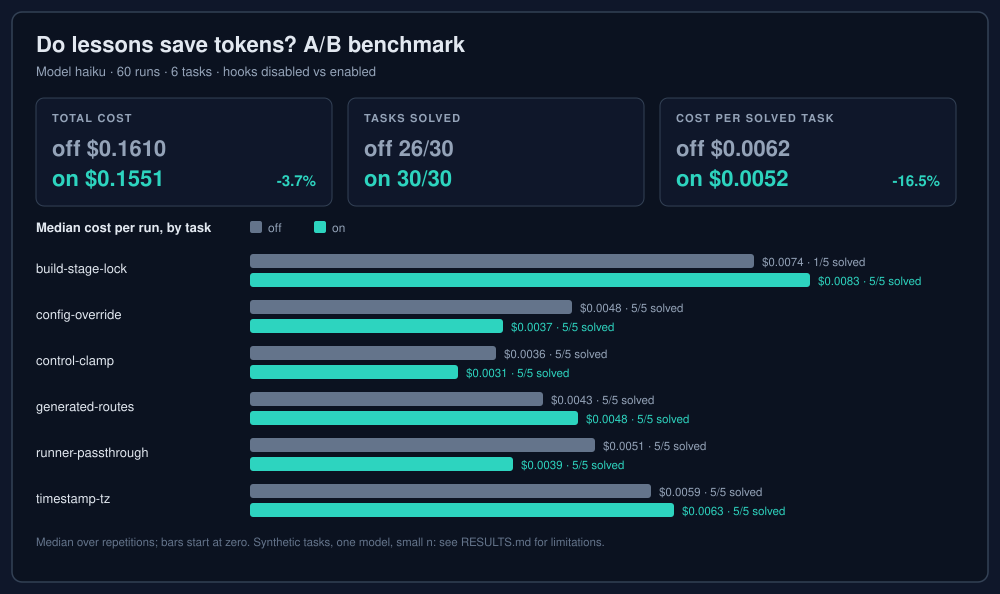

# Token cost benchmark: results

Generated by `benchmarks/token-cost/report.js` from `2026-11-04-haiku.jsonl`. Model: haiku. Runs: 60 (30 off, 30 on).

## Method

An agent works on a small synthetic project that contains one non-obvious gotcha. A "previous session" already solved that gotcha and left a lesson. Each task runs headless (`claude -p`) in two conditions:

- **off**: the hooks are installed but disabled (`MLP_DISABLE=1`).
- **on**: the hooks are enabled. The lessons store holds the lesson of every task plus the six generic example lessons, so the matcher has to pick the right one.

A run counts as solved only if the task's `verify.js` exits 0 afterwards. Cost, tokens and turns come from the Claude Code JSON result. Tokens are input + output + cache read + cache creation. One task is a control with no relevant lesson, to show the overhead when nothing matches.

## Per task

| Task | Solved off | Solved on | Median cost off | Median cost on | Δ cost | Median tokens off | Median tokens on | Median turns off | Median turns on | Runs with injection (on) |
|---|---|---|---|---|---|---|---|---|---|---|
| build-stage-lock | 1/5 | 5/5 | $0.0074 | $0.0083 | +11.1% | 363,819 | 408,279 | 10 | 13 | 5/5 |
| config-override | 5/5 | 5/5 | $0.0048 | $0.0037 | -21.6% | 194,339 | 116,474 | 9 | 5 | 5/5 |
| control-clamp | 5/5 | 5/5 | $0.0036 | $0.0031 | -15.4% | 151,646 | 113,236 | 4 | 3 | 0/5 |
| generated-routes | 5/5 | 5/5 | $0.0043 | $0.0048 | +11.7% | 154,886 | 194,275 | 10 | 10 | 0/5 |
| runner-passthrough | 5/5 | 5/5 | $0.0051 | $0.0039 | -23.9% | 233,775 | 154,366 | 8 | 4 | 5/5 |
| timestamp-tz | 5/5 | 5/5 | $0.0059 | $0.0063 | +5.7% | 237,363 | 277,166 | 10 | 9 | 5/5 |
| **All runs** | 26/30 | 30/30 | $0.0049 | $0.0044 | -10.2% | 194,977 | 156,141 | 9 | 5.5 | 20/30 |

## Totals

| | off | on | Δ |
|---|---|---|---|
| Total cost | $0.1610 | $0.1551 | -3.7% |
| Total tokens | 7,146,729 | 6,724,994 | -5.9% |
| Total turns | 266 | 229 | -13.9% |
| Solved runs | 26/30 | 30/30 | |
| **Cost per solved task** | $0.0062 | $0.0052 | -16.5% |

Cost per solved task is total cost of all runs in the condition divided by the number of solved runs, so failed runs count against a condition.

## Limitations

- **Synthetic tasks.** Five tiny projects written for this benchmark, each with a gotcha chosen so that a lesson helps. Real projects are larger and noisier.
- **One model.** Results for haiku say nothing certain about other models.
- **Small n.** A handful of repetitions per cell. Medians over a few runs move a lot; treat differences of a few percent as noise.
- **Lessons written in advance.** The lessons were written by hand with the solution known, and their keywords were chosen to match the task phrasing. In real use a lesson comes from an earlier failed session and may match worse (or be wrong).
- **Delivery is guaranteed, use is not.** The hooks deliver a matching lesson deterministically, but the benchmark cannot force the model to follow it. A run counted as "injected" only means the text reached the context.
- **Overhead is included.** In the "on" condition the injected text adds input tokens; the control task shows that cost when nothing matches.
- **Fixed environment.** Runs use a fixed time zone and a restricted tool set; results may differ in an unrestricted session.
