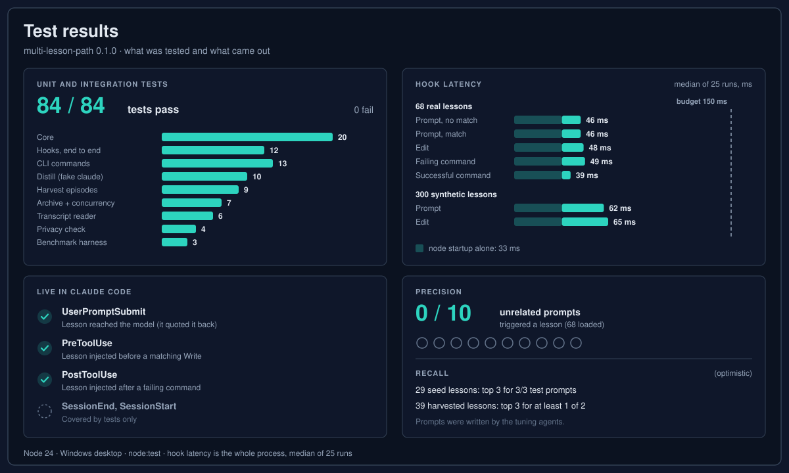
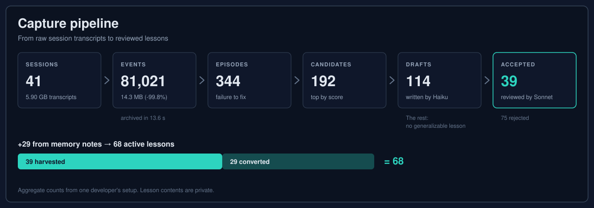
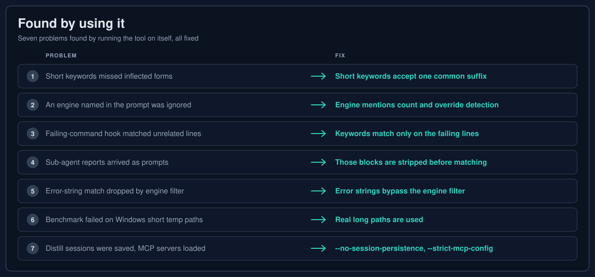
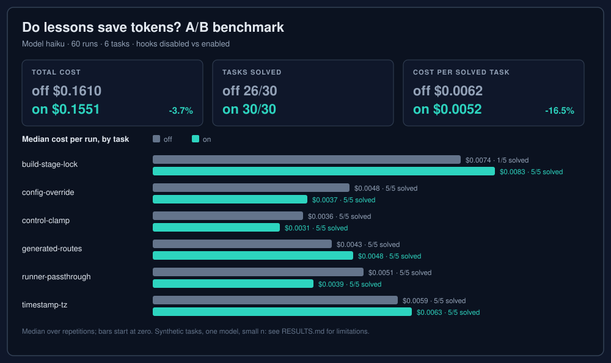

**Language:** English · [Türkçe](RESULTS.tr.md)

# Test results

multi-lesson-path is cross-project memory for Claude Code: short reviewed lessons that hooks inject when a matching situation starts. This page lists what was tested for version 0.1.0 and what came out, including what the numbers do not show.

## How it was built and tested

- **Planning.** The design was written down first (`docs/SPEC.md`), including a hook latency budget of 150 ms.
- **Implementation by sub-agents.** Separate agents built the parts (core matcher, hooks, CLI, archive, harvest, distill, benchmark), each with its own tests.
- **Review.** A second pass reviewed each part and tuned matching on example prompts.
- **Live use.** The tool was then installed and used on its own development, inside real Claude Code sessions. The problems that turned up are listed [below](#found-by-using-it).

## Unit and integration tests

84 tests, 84 pass, 0 fail (`node:test`, Node 24, Windows).

| Area | Tests |
|---|---|
| Core (normalization, globs, keywords, ranking, lesson parsing) | 20 |
| Hooks (all hook kinds end to end as child processes, de-dup, disabled switch, noise filters) | 12 |
| CLI commands | 13 |
| Distill with a fake `claude` binary | 10 |
| Harvest episode detection | 9 |
| Archive, including concurrency | 7 |
| Transcript reader | 6 |
| Privacy check | 4 |
| Benchmark harness | 3 |
| **Total** | **84** |

## Hook latency

Median of 25 runs of the whole process (`node mlp.js hook <kind>`) on a Windows desktop. Starting Node alone takes 33 ms. The design budget is 150 ms.

| Hook | 68 real lessons | 300 synthetic lessons |
|---|---|---|
| Prompt (no match) | 46 ms | 62 ms |
| Prompt (match) | 46 ms | |
| Edit | 48 ms | 65 ms |
| Failing command | 49 ms | |
| Successful command | 39 ms | |

## Live checks in Claude Code

| Hook | Check | Result |
|---|---|---|
| UserPromptSubmit | A lesson reached the model (a headless `claude -p` session was asked to quote it) | Verified |
| PreToolUse | The matching lesson was injected before a Write to a file matching the lesson's glob | Verified |
| PostToolUse | The matching lesson was injected after a failing command whose output contained the lesson's error string | Verified |
| SessionEnd, SessionStart | | Covered by tests only |

## Precision and recall

| Check | Result |
|---|---|
| Precision: 10 unrelated everyday prompts (for example "update the README and commit", "run the tests", "explain this error") against 68 lessons | 0 lessons injected |
| Recall: 29 seed lessons | In the top 3 for 3/3 of their test prompts |
| Recall: 39 harvested lessons | In the top 3 for at least 1 of 2 test prompts |

The recall prompts were written by the agents that tuned the matcher, so the recall numbers are optimistic.

## Capture pipeline

Aggregate counts from one developer's real local setup. The lesson contents are private and not published.

| Step | Count |
|---|---|
| Claude Code sessions | 41 (5.90 GB of transcripts) |
| Condensed archive | 81,021 events, 14.3 MB (-99.8%), archived in 13.6 s |
| Failure-to-fix episodes found | 344 |
| Candidates kept (top by score) | 192 |
| Draft lessons written by Claude Haiku | 114 (the rest: "no generalizable lesson") |
| Accepted after review by Claude Sonnet | 39 (75 rejected) |
| Converted from existing memory notes | 29 |
| **Active lessons** | **68** |

## Found by using it

| # | Problem | Fix |
|---|---|---|
| 1 | Short Turkish keywords missed inflected forms | Short keywords accept one common suffix |
| 2 | An engine named in the prompt was ignored, and the working directory's stack filtered lessons out | An engine named in the prompt counts as a keyword and overrides directory detection |
| 3 | The failing-command hook matched keywords in unrelated output lines | Keywords are matched only on the failing lines |
| 4 | Sub-agent reports and harness notifications arrived as prompts and triggered lessons | Those blocks are stripped |
| 5 | An error-string match was dropped because of the engine filter | Error strings bypass the filter |
| 6 | The benchmark failed every run because Windows 8.3 short temp paths made Claude Code deny edits | Real long paths are used |
| 7 | Distill sessions were saved and loaded MCP servers | `--no-session-persistence` and `--strict-mcp-config` |

## Token cost benchmark

Haiku, 60 runs: tasks solved 26/30 with lessons off and 30/30 with lessons on; total cost -3.7%; cost per solved task -16.5%. The control task, which has no relevant lesson, varied by 15% between conditions, so per-task differences within +/-20% are noise. Method and per-task numbers: [benchmarks/token-cost/RESULTS.md](../benchmarks/token-cost/RESULTS.md).

## What this does not show

- **The benchmark is synthetic and small.** Six small tasks, each with one planted gotcha, 60 runs in total.
- **One model.** The benchmark used Haiku only.
- **Recall prompts were written by the same agents** that tuned the matcher. Real prompts will miss more.
- **Real-world help rate is not measured yet.** The tests show that lessons arrive at the right moment, not how often they change the outcome of real work. Run `mlp stats` to see hits per lesson and hook event, and `mlp review` to find lessons that never fire or were marked wrong.
- **Capture numbers come from one setup.** Yield and acceptance rates will differ elsewhere.
- **Session hooks are tested, not live-checked.** SessionEnd archiving and SessionStart are covered by tests only.
