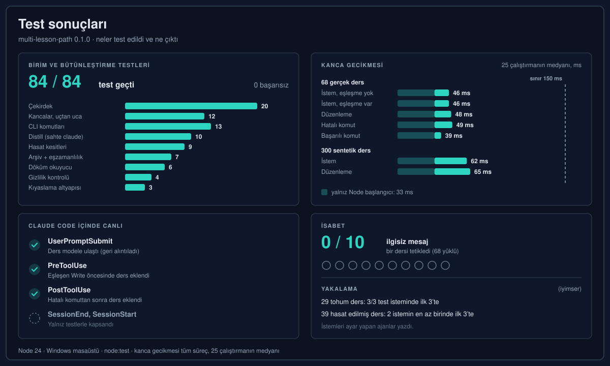
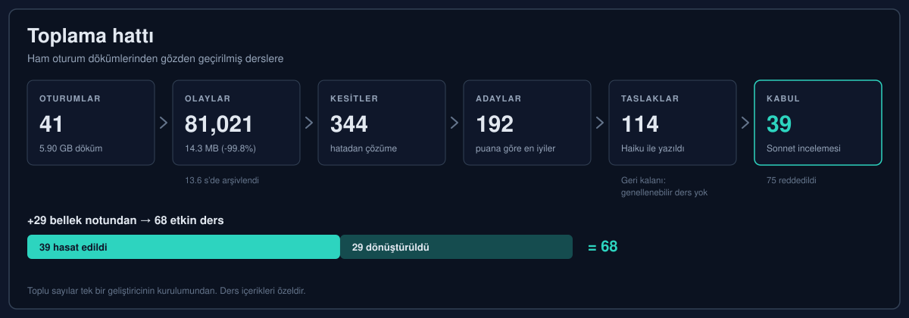
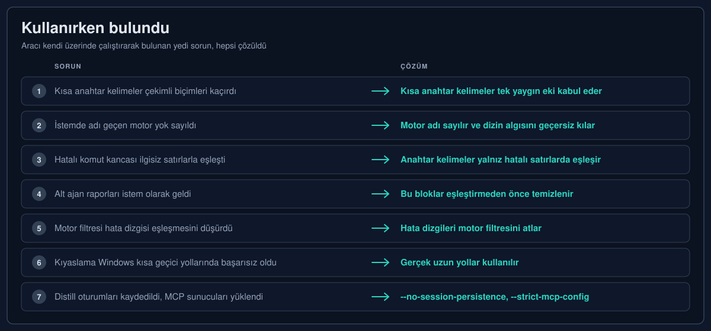
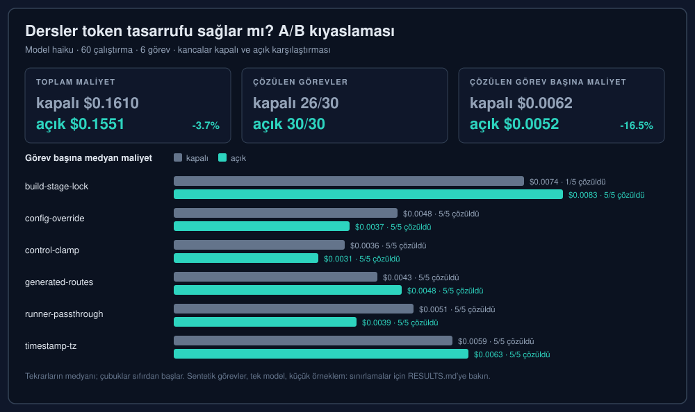

**Dil:** [English](RESULTS.md) · Türkçe

# Test sonuçları

multi-lesson-path, Claude Code için projeler arası bellektir: kısa, gözden geçirilmiş dersler, eşleşen bir durum başladığında kancalar tarafından eklenir. Bu sayfa 0.1.0 sürümü için neyin test edildiğini ve ne çıktığını listeler; sayıların göstermediği şeyler de dahil.

## Nasıl yapıldı ve test edildi

- **Planlama.** Tasarım önce yazıldı (`docs/SPEC.md`), 150 ms'lik kanca gecikme sınırı dahil.
- **Alt ajanlarla uygulama.** Ayrı ajanlar parçaları kurdu (çekirdek eşleştirici, kancalar, CLI, arşiv, hasat, distill, kıyaslama); her biri kendi testleriyle.
- **İnceleme.** İkinci bir geçiş her parçayı inceledi ve eşleştirmeyi örnek istemler üzerinde ayarladı.
- **Canlı kullanım.** Araç daha sonra kendi geliştirmesinde, gerçek Claude Code oturumları içinde kuruldu ve kullanıldı. Ortaya çıkan sorunlar [aşağıda](#kullanırken-bulundu) listelendi.

## Birim ve bütünleştirme testleri

84 testin 84'ü geçti, 0 başarısız (`node:test`, Node 24, Windows).

| Alan | Testler |
|---|---|
| Çekirdek (normalleştirme, glob'lar, anahtar kelimeler, sıralama, ders ayrıştırma) | 20 |
| Kancalar (tüm kanca türleri uçtan uca alt süreç olarak, tekilleştirme, devre dışı anahtarı, gürültü filtreleri) | 12 |
| CLI komutları | 13 |
| Sahte `claude` ikilisiyle distill | 10 |
| Hasat kesiti tespiti | 9 |
| Arşiv, eşzamanlılık dahil | 7 |
| Döküm okuyucu | 6 |
| Gizlilik kontrolü | 4 |
| Kıyaslama altyapısı | 3 |
| **Toplam** | **84** |

## Kanca gecikmesi

Tüm sürecin (`node mlp.js hook <kind>`) Windows masaüstünde 25 çalıştırmanın medyanı. Yalnız Node başlatmak 33 ms sürer. Tasarım sınırı 150 ms.

| Kanca | 68 gerçek ders | 300 sentetik ders |
|---|---|---|
| İstem (eşleşme yok) | 46 ms | 62 ms |
| İstem (eşleşme var) | 46 ms | |
| Düzenleme | 48 ms | 65 ms |
| Hatalı komut | 49 ms | |
| Başarılı komut | 39 ms | |

## Claude Code içinde canlı kontroller

| Kanca | Kontrol | Sonuç |
|---|---|---|
| UserPromptSubmit | Bir ders modele ulaştı (başsız bir `claude -p` oturumundan onu alıntılaması istendi) | Doğrulandı |
| PreToolUse | Eşleşen ders, dersin glob'una uyan bir dosyaya yapılan Write öncesinde eklendi | Doğrulandı |
| PostToolUse | Eşleşen ders, çıktısında dersin hata dizgisi bulunan hatalı bir komuttan sonra eklendi | Doğrulandı |
| SessionEnd, SessionStart | | Yalnız testlerle kapsandı |

## İsabet ve yakalama

| Kontrol | Sonuç |
|---|---|
| İsabet: 68 derse karşı 10 sıradan ilgisiz istem (örneğin "update the README and commit", "run the tests", "explain this error"; bunlar test girdilerinin birebir metnidir) | 0 ders eklendi |
| Yakalama: 29 tohum ders | Test istemlerinin 3/3'ünde ilk 3'te |
| Yakalama: 39 hasat edilmiş ders | 2 test isteminin en az birinde ilk 3'te |

Yakalama istemlerini eşleştiriciyi ayarlayan ajanlar yazdı; bu yüzden yakalama sayıları iyimserdir.

## Toplama hattı

Sayılar tek bir geliştiricinin gerçek yerel kurulumundan toplandı. Ders içerikleri özeldir ve yayımlanmamıştır.

| Adım | Sayı |
|---|---|
| Claude Code oturumları | 41 (5.90 GB döküm) |
| Yoğunlaştırılmış arşiv | 81,021 olay, 14.3 MB (-99.8%), 13.6 s'de arşivlendi |
| Bulunan hatadan çözüme kesitler | 344 |
| Tutulan adaylar (puana göre en iyiler) | 192 |
| Claude Haiku tarafından yazılan taslak dersler | 114 (kalanı: "genellenebilir ders yok") |
| Claude Sonnet incelemesinden sonra kabul | 39 (75 reddedildi) |
| Mevcut bellek notlarından dönüştürülen | 29 |
| **Etkin dersler** | **68** |

## Kullanırken bulundu

| # | Sorun | Çözüm |
|---|---|---|
| 1 | Kısa Türkçe anahtar kelimeler çekimli biçimleri kaçırdı | Kısa anahtar kelimeler tek yaygın eki kabul eder |
| 2 | İstemde adı geçen bir motor yok sayıldı ve çalışma dizininin yığını dersleri eledi | İstemde adı geçen motor anahtar kelime sayılır ve dizin algılamayı geçersiz kılar |
| 3 | Hatalı komut kancası, ilgisiz çıktı satırlarındaki anahtar kelimelerle eşleşti | Anahtar kelimeler yalnız hatalı satırlarda eşleşir |
| 4 | Alt ajan raporları ve harness bildirimleri istem olarak geldi ve dersleri tetikledi | Bu bloklar eşleştirmeden önce temizlenir |
| 5 | Motor filtresi yüzünden bir hata dizgisi eşleşmesi düştü | Hata dizgileri motor filtresini atlar |
| 6 | Windows 8.3 kısa geçici yolları Claude Code'un düzenlemeleri reddetmesine yol açtığı için kıyaslama her çalıştırmada başarısız oldu | Gerçek uzun yollar kullanılır |
| 7 | Distill oturumları kaydedildi ve MCP sunucuları yüklendi | `--no-session-persistence` ve `--strict-mcp-config` |

## Token maliyeti kıyaslaması

Haiku, 60 çalıştırma: dersler kapalıyken 26/30, açıkken 30/30 görev çözüldü; toplam maliyet -3.7%; çözülen görev başına maliyet -16.5%. İlgili dersi olmayan kontrol görevi koşullar arasında %15 değişti; bu yüzden görev bazındaki +/-20% içindeki farklar gürültüdür. Yöntem ve görev bazındaki sayılar: [benchmarks/token-cost/RESULTS.md](../benchmarks/token-cost/RESULTS.md).

## Bu neyi göstermiyor

- **Kıyaslama sentetik ve küçük.** Her biri tek bir gizli tuzak içeren altı küçük görev; toplam 60 çalıştırma.
- **Tek model.** Kıyaslamada yalnız Haiku kullanıldı.
- **Yakalama istemleri** eşleştiriciyi ayarlayan ajanlar tarafından yazıldı. Gerçek istemler daha fazla kaçıracaktır.
- **Gerçek dünyadaki yardım oranı henüz ölçülmedi.** Testler derslerin doğru anda geldiğini gösterir, ama gerçek işin sonucunu ne sıklıkla değiştirdiğini göstermez. Ders başına tetiklenmeleri ve kanca olaylarını görmek için `mlp stats`, hiç tetiklenmeyen ya da yanlış işaretlenen dersleri bulmak için `mlp review` çalıştırın.
- **Toplama sayıları tek bir kurulumdan.** Verim ve kabul oranları başka yerlerde farklı olacaktır.
- **Oturum kancaları test edildi, canlı kontrol edilmedi.** SessionEnd arşivleme ve SessionStart yalnız testlerle kapsanıyor.
